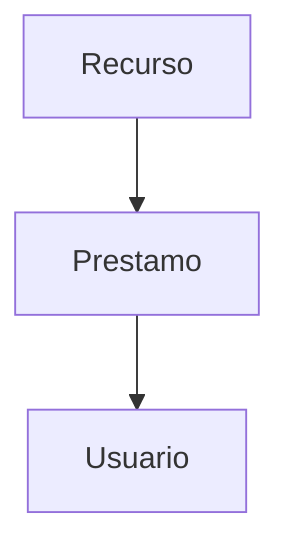
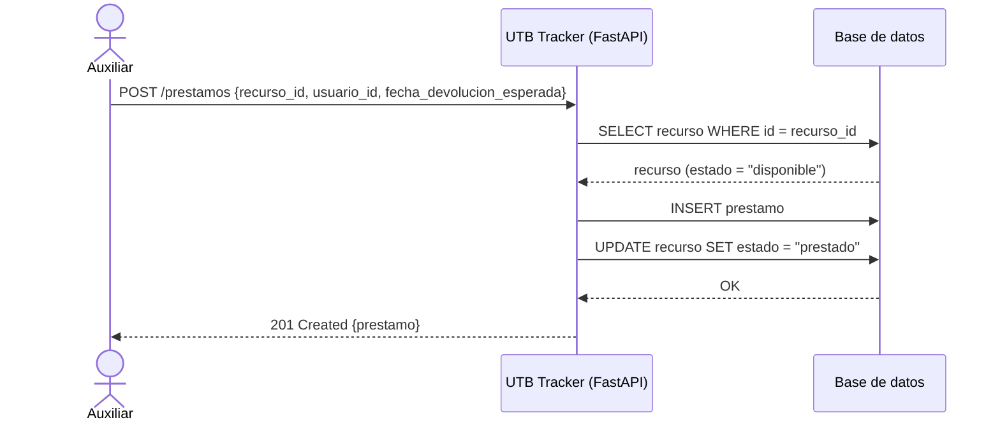
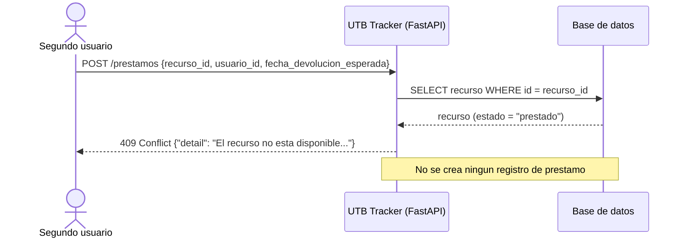
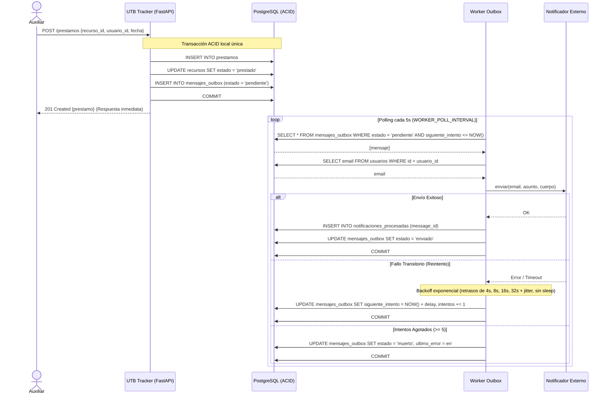
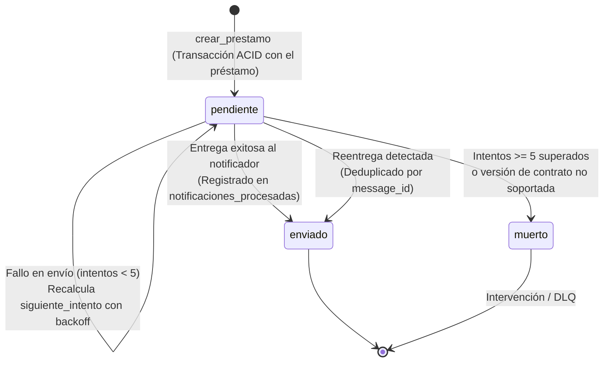
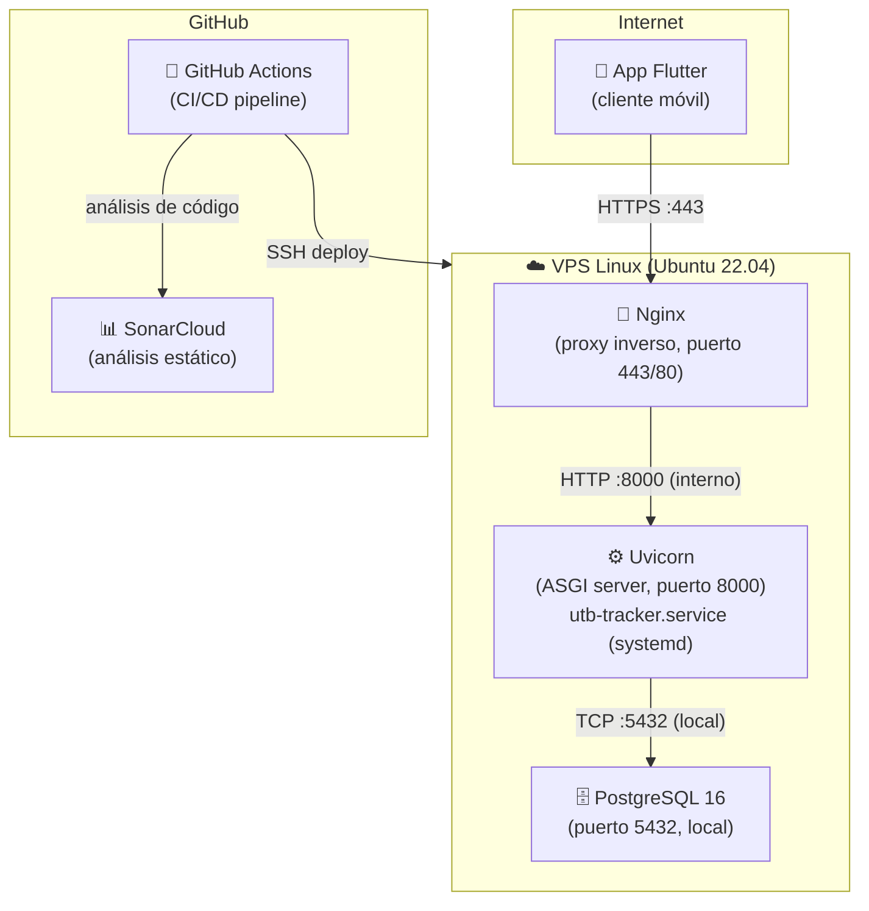

# 

**About arc42**

arc42, the template for documentation of software and system
architecture.

Template Version 9.0-EN. (based upon AsciiDoc version), July 2025

Created, maintained and © by Dr. Peter Hruschka, Dr. Gernot Starke and
contributors. See <https://arc42.org>.

# Introducción y objetivos

## Descripción general de los requisitos

UTB Tracker es un sistema movil dirigido a los auxiliares de planta de la UTB. Este sistema ayudara a mantener un registro de los objetos electronicos de cada salon de la universidad como video beams, computadores, aires acondicionados, etc. Esto para saber el estado actual de los aparatos, su ubicación y funcionalidad.

Este sistema busca ayudar a los auxiliares de planta y de laboratorio a la hora de que se presten aparatos a profesores o estudiantes como video beams asi manteniendo un registro de a quien se presto y a que salon fue llevado cada aparato. Ademas mantiene un registro de la funcionalidad de los aparatos de cada salon para saber si por ejemplo el computador numero 24 del salon A1-304 esta dañado y se debe someter a mantenimiento.

Finalmente el sistema esta dirigido tanto a auxiliares de planta y laboratorio asi como a profesores y estudiantes interesados por prestar aparatos electronicos de los salones o de los laboratorios de la UTB.


## Objetivos de calidad

Los objetivos de calidad se derivaron directamente de los problemas que UTB Tracker busca resolver
(sección 2 del documento de idea) y de las reglas de negocio que dependen de que el sistema sea confiable.

| # | Objetivo de calidad | Motivación |
|---|---|---|
| 1 | **Confiabilidad de los datos** | El problema central que resuelve el sistema es la falta de un registro confiable del estado de cada recurso; si el estado (disponible/prestado/dañado) puede quedar inconsistente, el sistema no resuelve nada mejor que el proceso actual. |
| 2 | **Usabilidad** | El auxiliar de planta necesita registrar préstamos rápido, sin fricción, mientras atiende a varias personas; el estudiante/profesor necesita pedir un préstamo sin pasos innecesarios. |
| 3 | **Seguridad** | Hay dos roles con permisos distintos (administrador vs. usuario UTB); un usuario no debería poder alterar el catálogo ni el estado de recursos que no le corresponden. |
| 4 | **Disponibilidad** | El sistema debe estar accesible durante el horario en que opera el campus, que es cuando ocurren los préstamos y devoluciones. |
| 5 | **Rendimiento** | La app debe responder rápido en los momentos de mayor uso (por ejemplo, inicio de semestre, cuando muchos profesores piden equipos a la vez). |

Estos cinco objetivos son la base del árbol de utilidad (sección 10).

## Stakeholders

| Role/Name | Contact | Expectations |
|--------------|-----------------|---------------------|
| **Auxiliar de planta** | Trabajador de la UTB encargado de apoyar el mantenimiento, la operación y el cuidado de la infraestructura física o de los laboratorios y talleres del campus | Llevar el historial de prestamos y ubicación de cada objeto prestado y tambien la disponibilidad y el estado de los objetos de los salones y laboratorios |
| **Profesores/Estudiantes** | Personas interesadas en hacer un prestamo de algun objeto | Solicitar el prestamo mediante la aplicación y recibir una confirmación mediante esta misma |
| **Equipo de desarrollo** | Sebastián García, Gerónimo Cadena, Joriel Samir Barros, Mateo Milán | Construir un sistema mantenible dentro del tiempo del semestre |
| **Docente / evaluador** | Profesor del curso | Verificar que la arquitectura documentada corresponda con lo implementado en el repositorio |

# Restricciones arquitectónicas

Cada restricción se documenta con su justificación: de dónde sale y qué implica para el diseño.
No son preferencias del equipo, son condiciones que ya vienen dadas y que la arquitectura tiene
que respetar. Las decisiones tecnológicas que el equipo sí eligió (Flutter, FastAPI, PostgreSQL)
no van aquí — están justificadas en la sección "Solution Strategy" y en `docs/adr/0002-*.md`.

**Restricciones técnicas**

| Restricción | Origen | Implicación arquitectónica |
|---|---|---|
| Solo pueden usarse las librerías/herramientas dadas o aprobadas por el profesor | Condición del curso | Limita las opciones de frameworks; cada dependencia nueva se valida antes de adoptarla |
| El backend debe exponerse como API consumible por un cliente móvil separado | El cliente es una app Flutter, no una interfaz servida por el propio backend | Backend y cliente quedan desacoplados por un contrato HTTP/JSON; cualquier cambio de ese contrato afecta a los dos lados a la vez |
| Los cambios de esquema de base de datos deben quedar versionados | El equipo usa PostgreSQL con Alembic para migraciones | El modelo de datos no se modifica "a mano" en producción; cada cambio de esquema pasa por una migración registrada |

**Restricciones organizacionales**

| Restricción | Origen | Implicación arquitectónica |
|---|---|---|
| El proyecto debe estar terminado dentro del semestre académico | Calendario del curso | Favorece una arquitectura simple y modular sobre una solución sobre-diseñada |
| Equipo de 4 personas, todas simultáneamente estudiantes de otras materias | Composición real del equipo | La arquitectura debe permitir trabajo en paralelo sin choques constantes (separación clara de módulos/responsabilidades) |

**Restricciones legales / normativas**

| Restricción | Origen | Implicación arquitectónica |
|---|---|---|
| Cumplimiento de la Ley de Protección de Datos Personales (Ley 1581 de 2012, Colombia) | El sistema registra datos personales de usuarios (nombre, rol) y trazabilidad de sus préstamos | El acceso a los datos de un usuario debe restringirse según su rol (administrador vs. usuario UTB); las credenciales (JWT) deben manejarse de forma segura |

# Contexto y alcance

## Contexto de negocio

UTB Tracker se situa en un contexto donde los **auxiliares de planta** de la UTB no tienen una herramienta que les facilite el registro de prestamos de objetos electronicos y de laboratorio ademas de un sistema para saber el estado de estos mismos. De modo que nuestro sistema busca ayudarles en esta labor con una solucion digital 


| Comunicación | Descripción | Formato / canal |
|---|---|---|
| Auxiliar de planta → UTB Tracker | Registra prestamos de objetos, actualiza estado de los objetos, crea nuevos objetos, elimina objetos, gestiona usuarios | Interfaz movil, HTTPS |
| Estudiante/Profesor → UTB Tracker | Solicita prestamos de objetos, deja comentarios de los objetos | Interfaz movil, HTTPS |
| UTB Tracker → Correo electronico | Envía correos automáticos de confirmación al solicitar un préstamo, recordatorios de devolución de equipos atrasados a estudiantes/profesores, o notificaciones a auxiliares sobre reportes de daños. | SMTP / HTML |

No hay integración con sistemas externos de terceros (por ejemplo, pasarelas de pago o sistemas
de otras empresas): el alcance actual es interno entre estos dos roles y el propio sistema.

## Contexto técnico

El auxiliar de planta accede normalmente desde la app móvil, muchas veces con conexión intermitente en el campus; el estudiante o profesor accede desde dispositivos con mejor conectividad. Esta diferencia obliga a la aplicación móvil a tolerar fallas temporales de conexión.


**Diagrama de contexto (C4 Nivel 1)**


*(Diagrama modelado utilizando la extension de *Mermaid* para VSCode. Muestra Auxiliar de planta y usuario UTB
como actores, UTB Tracker como sistema central, y un sistema externo: el sistema de correo electronico.)*

# Estrategia de solución

Esta sección resume las decisiones tecnológicas y de estilo que atraviesan todo el sistema, y
por qué se tomaron — el detalle completo de cada una vive en su propio ADR bajo `docs/adr/`.

## Decisiones tecnológicas

| Decisión | Motivación |
|---|---|
| Backend en FastAPI (Python) | Proporciona un desarrollo rápido, tipado estático con Pydantic para validación automática en los formularios (crucial para la usabilidad de QS-05) y documentación interactiva nativa (Swagger/OpenAPI). Se ejecuta mediante Uvicorn. |
| Persistencia en SQL (SQLAlchemy / Alembic) | Garantiza la integridad de las transacciones de préstamos mediante restricciones de clave foránea y transacciones ACID. Alembic maneja las migraciones de forma estructurada. |
| Arquitectura Monolítica Modular | Permite a los 4 desarrolladores trabajar en paralelo en sus propios módulos de dominio (`users`, `loans`, `resources`) bajo `app/routers/` reduciendo conflictos en Git y manteniendo fronteras claras. |

## Decisión de estilo arquitectónico

Se eligió **Monolito Modular**: un único desplegable dividido internamente en módulos de
dominio independientes (`users`, `loans`, `resources`).

La comparación completa contra los otros dos estilos evaluados (capas y hexagonal) está en
[`docs/matriz_estilos.md`](../matriz_estilos.md), y la decisión formal con alternativas
descartadas y consecuencias en
[`docs/adr/0001-estilo-arquitectonico.md`](../adr/0001-estilo-arquitectonico.md) (**ADR-0001**).

En resumen: se descartó *capas* porque el acoplamiento técnico dificulta que el equipo trabaje en paralelo, y se descartó *hexagonal* porque el exceso de indirección y andamiaje (puertos y adaptadores) consume demasiado tiempo valioso del semestre académico. El monolito modular en FastAPI ofrece el balance ideal entre límites claros de dominio y velocidad de desarrollo.

## Cómo se logran los objetivos de calidad principales

| Objetivo de calidad | Enfoque de solución |
|---|---|
| Disponibilidad / rendimiento (QS-01) | La asincronía nativa de FastAPI (utilizando endpoints `async def`) optimiza la concurrencia y los tiempos de respuesta del servidor frente a alta demanda en el campus. |
| Usabilidad (QS-05) | Al evitar indirección arquitectónica compleja, el equipo puede enfocarse en interfaces sencillas y en la validación automatizada en tiempo real que provee Pydantic. |
| Seguridad / Integridad (QS-03, QS-04) | Uso de dependencias de FastAPI (`Depends`) para inyectar políticas de autorización de forma limpia a nivel de router. Las contraseñas se almacenan cifradas con `bcrypt` (en lugar de texto plano). |
| Integridad de los Datos (QS-02) | Manejo de transacciones ACID nativas a través del ORM SQLAlchemy conectado a la base de datos SQL. |

# Estructura del sistema

## Vista general del sistema

**Diagrama**



**Motivación**

Cada módulo bajo `app/routers/` corresponde a un módulo de dominio, siguiendo el estilo Monolito Modular (ADR-0001). La estructura de carpetas del repositorio (`app/routers/resources.py`, `app/routers/loans.py`, etc.) coincide 1 a 1 con los bloques del diagrama.

**Bloques contenidos**

| Bloque | Estado en esta entrega |
|---|---|
| `health` | Completo desde S3 — endpoint de verificación |
| `usuarios` | Módulo declarado, sin lógica de negocio todavía |
| `recursos` | **Corte vertical S4**: crear, listar y consultar recursos |
| `prestamos` | **Corte vertical S4**: crear préstamo, con regla de negocio central |

**Interfaces importantes**

Todos los módulos se comunican vía HTTP/JSON. Internamente, `prestamos` depende de `recursos` (consulta y modifica estado). La dependencia está declarada explícitamente en `app/routers/loans.py`.

### recursos

*Responsabilidad:* mantener el catálogo de equipos y su estado (disponible/prestado/dañado).
*Interfaz:* `POST /recursos`, `GET /recursos`, `GET /recursos/{id}`.
*Ubicación:* `app/routers/resources.py`, modelo en `app/models.py::Recurso`.
*Requisitos que cumple:* base para QS-06 (confiabilidad de datos).

### prestamos

*Responsabilidad:* registrar préstamos y aplicar la regla "un recurso solo puede prestarse si está disponible".
*Interfaz:* `POST /prestamos`, `GET /prestamos`.
*Ubicación:* `app/routers/loans.py`, modelo en `app/models.py::Prestamo`.
*Requisitos que cumple:* QS-06 (confiabilidad de datos) probado en `tests/test_loans.py`.

## Nivel 2

### White Box *recursos*

router (resources.py) → schema (RecursoCreate / RecursoOut) → modelo (Recurso) → SQLite/PostgreSQL

El router valida la entrada con Pydantic, rechaza serial duplicado con 409 y devuelve salida validada.

### White Box *prestamos*

router (loans.py) → valida existencia y estado del Recurso → schema (PrestamoCreate/Out) → modelo (Prestamo) → SQLite/PostgreSQL → actualiza Recurso.estado a "prestado"

Antes de crear el préstamo, el router comprueba `recurso.estado == "disponible"`; si no, responde 409.

## Level 3

*(pendiente)*

# Runtime View

## Vista de ejecución

### Escenario 1 — Préstamo exitoso

Un auxiliar registra el préstamo de un recurso que está disponible.



**Aspectos notables:** la comprobación de disponibilidad y la actualización de estado ocurren en el mismo request.

### Escenario 2 — Préstamo rechazado (recurso no disponible)

Un segundo usuario intenta prestar el mismo recurso mientras ya está prestado.



**Aspectos notables:** este es el escenario de calidad QS-06, el sistema nunca permite dos préstamos activos sobre el mismo recurso.

### Escenario 3 — Notificación asíncrona de préstamo (Transactional Outbox + Worker)

Tras registrar exitosamente un préstamo, el sistema desacopla la notificación al usuario mediante el patrón Transactional Outbox para no comprometer la latencia ni la disponibilidad del endpoint ante caídas del servicio de correo ([ADR-0006](../adr/0006-mensajeria-asincrona-outbox.md)).



**Ciclo de Estados del Mensaje Outbox:**




## Infrastructure Level 1

El backend de UTB Tracker se despliega en un único servidor Linux (VPS) gestionado
manualmente mediante `systemd`. El proceso de entrega continua está automatizado con
GitHub Actions (`.github/workflows/ci.yml`).



**Motivación:**
El equipo opera con un presupuesto y tiempo académico limitados. Un único VPS con Nginx
como proxy inverso y Uvicorn gestionado por `systemd` cubre el escenario QS-03
(300 usuarios simultáneos) sin la sobrecarga operativa de contenedores o servicios
gestionados. La decisión de no usar microservicios está formalizada en
[ADR-0005](../adr/0005-monolito-vs-microservicios.md).

**Características de calidad y rendimiento:**
- **TLS terminado en Nginx:** todo el tráfico entre el cliente móvil y el servidor
  viaja cifrado (HTTPS), cumpliendo QS-04 y la Ley 1581 de 2012.
- **Proceso Uvicorn (API) gestionado por systemd:** el servicio web de la API se reinicia automáticamente
  si el proceso cae (`Restart=always`), contribuyendo a la disponibilidad QS-01. (Nota: el despliegue
  actual no arranca el worker de mensajería; este se ejecuta manualmente vía CLI cuando se requiere).
- **PostgreSQL local (mismo host):** la latencia de red entre el backend y la base de
  datos es prácticamente despreciable (loopback local), favoreciendo QS-02 (tiempo de respuesta).
- **Despliegue automatizado vía CI:** los cambios en `main` se despliegan sin
  intervención manual después de pasar las pruebas y el Quality Gate de SonarCloud.

**Mapeo de bloques constructivos a infraestructura:**

| Bloque (`app/`) | Infraestructura |
|---|---|
| `routers/health.py` — `GET /salud` | Uvicorn → PostgreSQL (`SELECT 1` activo) |
| `routers/resources.py` — `/recursos` | Uvicorn → PostgreSQL (tabla `recurso`) |
| `routers/loans.py` — `/prestamos` | Uvicorn → PostgreSQL (tablas `recurso`, `prestamo`, `mensajes_outbox`, transacción ACID) |
| `messaging/worker.py` — Worker Outbox | Ejecución manual CLI (`python -m app.messaging.worker`); no arrancado en el despliegue actual |
| `routers/auth.py` — `/auth` | Uvicorn → PostgreSQL (tabla `usuario`) |

## Infrastructure Level 2

### Estimación de costos mensuales (S8 — req. 8.10)

Costos aproximados para el entorno de producción del proyecto académico:

| Componente | Proveedor / opción | Costo mensual estimado |
|---|---|---|
| **VPS 2 vCPU / 4 GB RAM** | DigitalOcean Droplet / Linode / Oracle Free Tier | USD $12 – $24 (Oracle: $0 en capa gratuita) |
| **PostgreSQL** | Instancia local en el mismo VPS (incluida arriba) | $0 adicional |
| **Dominio `.com`** | Namecheap / Google Domains | USD $1 – $2 (prorrateado mensual) |
| **SSL/TLS** | Let's Encrypt (Certbot) | $0 |
| **SonarCloud** | Plan Community (repositorios públicos) | $0 |
| **GitHub Actions** | Plan Free (2 000 min/mes incluidos) | $0 |
| **Total estimado** | | **USD $0 – $26 / mes** |

> La capa gratuita de Oracle Cloud Infrastructure (Ampere A1 4 vCPU / 24 GB RAM)
> puede alojar el sistema completo en producción sin costo adicional durante la
> vida académica del proyecto.


# Conceptos transversales (Cross-cutting Concepts)

## 8.1 Patrón de Capas y Control de Erosión Arquitectónica
Para evitar la erosión del estilo Monolito Modular (S9 — req. 9.6), el backend implementa una separación estricta de tres capas en cada módulo de dominio:
1. **Capa de Enrutamiento HTTP (`app/routers/`):** Expone endpoints REST, valida datos de entrada mediante esquemas Pydantic y gestiona respuestas HTTP/códigos de estado (200, 201, 404, 409). No ejecuta lógica de negocio ni consultas directas al ORM.
2. **Capa de Servicio (`app/services/`):** Orquesta la lógica de negocio, reglas de dominio (ej. exclusividad de recursos en préstamo — QS-06) y transacciones de base de datos. Módulos: `services/resources.py`, `services/loans.py`, `services/auth.py`.
3. **Capa de Persistencia y Modelos (`app/models/` y `app/core/database.py`):** Define entidades SQLAlchemy mapeadas a tablas PostgreSQL y administra la sesión de conexión.

## 8.2 Seguridad, Hashing y Autenticación
- **Protección de Credenciales (QS-04 / ADR-0004 / req. 9.8):** Las contraseñas se almacenan exclusivamente como hashes irreversibles generados con `bcrypt` (sales dinámicas automáticas). El sistema nunca almacena ni compara contraseñas en texto plano.
- **Tokens de Acceso:** Uso de JSON Web Tokens (JWT) firmados con algoritmo simétrico HS256 (`PyJWT`), con tiempo de expiración configurable y verificación sin estado (*stateless*), desacoplando la autorización de la base de datos en cada consulta.

## 8.3 Observabilidad y Logging Estructurado
- **Middleware HTTP (`app/main.py`):** Cada petición entrante es interceptada para asignarle un identificador único correlativo (`request_id` formato UUID de 8 caracteres).
- **Formato Estructurado:** Los eventos de acceso se registran en formato JSON con marca de tiempo UTC, método HTTP, ruta, código de estado y latencia en milisegundos (`latency_ms`), listo para ingesta en herramientas de monitoreo como Grafana Loki o Datadog.
- **Sondeo de Salud Profundo (`app/routers/health.py`):** El endpoint `GET /salud` ejecuta activamente una consulta `SELECT 1` sobre el pool de PostgreSQL para validar la salud real de la infraestructura.

## 8.4 Evaluación de Inteligencia Artificial Generativa en el Producto (req. 9.9)
Se evaluó la posible integración de modelos de IA generativa (LLMs) dentro del flujo operativo de UTB Tracker.
- **Determinación Arquitectónica: NO APLICA / NO SE INTEGRA EN RUNTIME.**
- **Justificación:** UTB Tracker es un sistema de misión crítica para el control y la trazabilidad de inventario físico en salones de clase. Los requisitos centrales del sistema son la **consistencia transaccional inmediata (QS-06)** y la **alta confiabilidad y predictibilidad (QS-03)**. Los modelos generativos introducen no determinismo, latencia adicional de inferencia y costos de API externos que no agregan valor al registro transaccional de préstamos. La IA se utiliza exclusivamente como herramienta de asistencia en el desarrollo y revisión de código por el equipo de ingeniería, documentada en `docs/ia.md`.

## 8.5 Resiliencia, Timeouts y Reintentos (S11 — req. 11.1 y 11.2)
- **Pool de Conexiones Resiliente (`app/core/database.py`):** Configurado con `pool_size=10`, `max_overflow=20`, `pool_timeout=30`, `pool_recycle=1800` y `pool_pre_ping=True`. La validación de ping previo descarta conexiones inactivas cerradas por el kernel o firewall, eliminando errores `OperationalError` tras periodos de inactividad.
- **Reintentos con Backoff y Jitter (`app/core/resilience.py`):** Decorador `@with_retry` implementado para tolerar fallos transitorios en conexiones de red o base de datos. Emplea la fórmula `delay = min(max_delay, base_delay * 2^intento) + random_jitter`, mitigando problemas de sincronización de reintentos concurrentes (*thundering herd*).

## 8.6 Idempotencia y Prevención de Condiciones de Carrera (S11 — req. 11.3 y R-02)
- **Idempotencia de Préstamos (`app/routers/loans.py`, `app/services/loans.py`):** Soporte para la cabecera `X-Idempotency-Key`. Los clientes móviles reintentan peticiones de forma transparente ante fluctuaciones de Wi-Fi; el backend registra la clave en `idempotencia_registros` y devuelve el préstamo original sin duplicar registros ni emitir falsos errores 409.
- **Bloqueo Pesimista de Fila (QS-06):** Para evitar la condición de carrera identificada en R-02, la consulta del recurso en `crear_prestamo` aplica bloqueo pesimista `.with_for_update()`, serializando solicitudes que intenten prestar el mismo equipo simultáneamente.

## 8.7 Descomposición: Sagas, Patrón Outbox y Circuit Breakers (S11/S12 — req. 11.4, 11.5 y 11.6)
- **Regla central de negocio (Préstamos): Transacción ACID local:** La validación de disponibilidad y asignación del préstamo ocurren en un único `db.commit()` atómico local, garantizando consistencia inmediata (QS-06). Las Sagas no aplican para la reserva del recurso.
- **Transactional Outbox para Notificaciones Desacopladas (S12 / ADR-0006):** Para los efectos colaterales secundarios (notificación por correo al usuario), se implementó el patrón Transactional Outbox ([ADR-0006](../adr/0006-mensajeria-asincrona-outbox.md)). La inserción en `mensajes_outbox` comparte la transacción del préstamo; un proceso consumidor (`app/messaging/worker.py`) entrega las notificaciones de forma asíncrona con semántica *at-least-once*, deduplicación en `notificaciones_procesadas` y reintentos con backoff exponencial.
- **Circuit Breaker (`app/core/resilience.py`):** Se provee la clase `CircuitBreaker` para aislar fallos en integraciones externas directas, alternando estados CLOSED, OPEN y HALF_OPEN para evitar caídas en cascada.
- **Decisión de Microservicios:** Formalizada en [ADR-0005](../adr/0005-monolito-vs-microservicios.md), donde se fundamenta el rechazo de microservicios para maximizar la consistencia transaccional y simplicidad operativa del equipo.

## 8.8 Estrategia de Consistencia de Datos
El sistema define garantías explícitas por cada operación de lectura y escritura. La regla de oro establece que las operaciones de escritura validan invariantes exclusivamente contra la base de datos primaria bajo transacciones ACID locales (con bloqueo pesimista en préstamos y restricciones declarativas en modelos). Para el detalle exhaustivo por operación, garantías del flujo por eventos y análisis de brechas de concurrencia, consultar [`docs/datos/consistencia-por-operacion.md`](../datos/consistencia-por-operacion.md).

## 8.9 Estrategia de Caché (Diseño Propuesto)
Para mitigar la sobrecarga en horas pico (QS-02, QS-03) sin comprometer la consistencia de inventario (QS-06), se diseña una capa de caché en memoria de proceso acotada por TTL (60 s para recursos, 120 s para salones) con invalidación por grupos de versión ante eventos de escritura. Ninguna operación de modificación lee de la caché. Especificación técnica completa en [`docs/datos/diseno-cache.md`](../datos/diseno-cache.md) *(DISEÑO PROPUESTO — NO IMPLEMENTADO)*.


# Decisiones arquitectónicas

Las decisiones de arquitectura se documentan como ADR individuales en `docs/adr/`, no en esta
sección. Índice de decisiones tomadas hasta ahora:

- [ADR-0001](../adr/0001-estilo-arquitectonico.md) — Estilo arquitectónico: Monolito Modular (S3)
- [ADR-0002](../adr/0002-cambio-stack-fastapi-flutter.md) — Cambio de stack: Django → FastAPI + Flutter (S4)
- [ADR-0003](../adr/0003-integracion-sincrona.md) — Integración entre módulos: llamadas directas síncronas (S4)
- [ADR-0004](../adr/0004-seguridad-jwt.md) — Seguridad y Autenticación: JWT HS256 + bcrypt (S8)
- [ADR-0005](../adr/0005-monolito-vs-microservicios.md) — Preservación del Monolito Modular: rechazo de microservicios (S8)
- [ADR-0006](../adr/0006-mensajeria-asincrona-outbox.md) — Mensajería Asíncrona: Transactional Outbox para notificaciones de préstamos (S12)
- [ADR-0007](../adr/0007-identificadores-enteros-autoincrementales.md) — Identificadores enteros autoincrementales en claves primarias (S12)

# Requisitos de calidad

## Descripción general de los requisitos de calidad

El árbol parte de los cinco objetivos de calidad definidos en la sección "Introducción y objetivos".
Cada rama se desglosa en atributos concretos y se prioriza con dos ejes: **importancia para el
negocio** y **dificultad técnica de lograrlo** (Alta/Media/Baja, Alta/Media/Baja).

```
Utilidad (UTB Tracker)
│
├── Confiabilidad de los datos
│   └── El sistema le da la confianza a quien lo usa de que el estado de los objetos (Prestado/funcionando/dañado) es correcto en todo momento      [Alta / Media]
│
├── Usabilidad
│   ├── Necesita ser rapida e intuitiva para el auxiliar de planta a la hora de registrar un prestamo, devolverlo o registrar daños. [Alta / Media]
│   └── Necesita ser rapida e intuitiva para los docentes/estudiantes a la hora de pedir prestamos de forma concurrente.                       [Alta / Media]
│
├── Seguridad
│   ├── Proteccion de usuarios. Solo el usuario y el administrador pueden ingresar al sistema y cada uno tiene distintos permisos                  [Alta / Alta]
│   └── Confidencialidad de datos de facturación entre propietarios       [Alta / Media]
│
├── Disponibilidad
│   └── El sistema debe estar disponible en los horarios donde se encuentran trabajando los auxiliares de planta     [Media / Baja]
│
└── Rendimiento
    └── El sistema debe poder soportar varias solicitudes a la vez y responder en un tiempo razonable [Alta / Media]
```

## Escenarios de calidad

Se documentan 5 escenarios, uno por rama principal del árbol, en formato
Fuente–Estímulo–Ambiente–Artefacto–Respuesta–Medida (SEI). Cada uno está enlazado desde su
aspecto correspondiente en `docs/aspectos.md`.

### QS-01 — Disponibilidad


| Campo | Descripción |
|---|---|
| **Fuente** | Auxiliar o profesor/estudiante |
| **Estímulo** | Intenta acceder al sistema |
| **Ambiente** | Horario habitual del campus (7:00 a.m. – 7:00 p.m.) |
| **Artefacto** | Servicio movil de UTB Tracker |
| **Respuesta** | El sistema atiende la solicitud sin caída del servicio |
| **Medida** | Disponibilidad ≥ 99% del tiempo dentro de la ventana 7am–7pm |

### QS-02 — Rendimiento (tiempo de respuesta)

| Campo | Descripción |
|---|---|
| **Fuente** | Auxiliar o profesor/estudiante |
| **Estímulo** | Abre la aplicación o navega a una nueva vista |
| **Ambiente** | Operación normal, dispositivo conectado (probablemente) al internet del campus |
| **Artefacto** | Servicio movil de UTB Tracker |
| **Respuesta** | La vista carga y queda interactiva |
| **Medida** | Tiempo de carga ≤ 3 segundos |
| **Evidencia empírica (S9)** | Evaluada con `tests/test_performance.py`: p50 de respuesta API ~4 ms, p95 < 25 ms, muy por debajo del umbral de 3 s |

### QS-03 — Rendimiento (concurrencia)

| Campo | Descripción |
|---|---|
| **Fuente** | Auxiliar o profesor/estudiante |
| **Estímulo** | Múltiples usuarios usan el sistema al mismo tiempo (hora pico) |
| **Ambiente** | Operación normal |
| **Artefacto** | Backend / API de UTB Tracker |
| **Respuesta** | El sistema procesa las solicitudes sin degradar el servicio |
| **Medida** | Soporta al menos 300 usuarios simultáneos sin errores ni caídas |
| **Evidencia empírica (S9)** | `tests/test_performance.py::test_concurrencia_solicitudes_simultaneas`: 50 peticiones simultáneas con ThreadPool, 100% de tasa de éxito (HTTP 200), 0 caídas o timeouts |


### QS-04 — Seguridad

| Campo | Descripción |
|---|---|
| **Fuente** | Usuario sin rol de auxiliar/administrador, o un atacante externo |
| **Estímulo** | Intenta registrar, modificar o eliminar un recurso del catálogo (objeto o salón) |
| **Ambiente** | Operación normal del sistema |
| **Artefacto** | Módulo de autorización / API de gestión de recursos |
| **Respuesta** | El sistema bloquea la acción, deniega el acceso y no altera la base de datos |
| **Medida** | 0% de operaciones de modificación no autorizadas permitidas; tokens de sesión (JWT) firmados de forma segura |

### QS-05 — Usabilidad

| Campo | Descripción |
|---|---|
| **Fuente** | Auxiliar de planta / laboratorio |
| **Estímulo** | Debe registrar el préstamo de un equipo o reportar un daño por primera vez, sin capacitación previa |
| **Ambiente** | Operación normal en el campus (con usuarios en fila para atención) |
| **Artefacto** | Formulario de registro de préstamo o daño en la app móvil |
| **Respuesta** | El auxiliar completa la operación correctamente |
| **Medida** | Completa el registro del préstamo o reporte en menos de 1 minuto y en su primer intento, sin cometer errores críticos |

### QS-06 — Confiabilidad de los datos

| Campo | Descripción |
|---|---|
| **Fuente** | Dos auxiliares o usuarios que intentan prestar el mismo recurso simultáneamente |
| **Estímulo** | Dos peticiones `POST /prestamos` concurrentes sobre el mismo `recurso_id` |
| **Ambiente** | Hora pico del campus, red del campus |
| **Artefacto** | Módulo de préstamos (`app/routers/loans.py`) + PostgreSQL |
| **Respuesta** | Solo una petición crea el préstamo; la segunda recibe 409 Conflict sin crear ningún registro |
| **Medida** | 0% de recursos con dos préstamos activos simultáneos; segunda petición siempre recibe 409 |

# Riesgos y deudas técnicas

Identificados durante la auditoría arquitectónica (Semanas 8, 9 y 11). Ver informe completo
en `docs/auditoria_s8_s9_s11.md`.

| # | Riesgo / Deuda Técnica | Impacto | Mitigación y Estado |
|---|---|---|---|
| **R-01** | Contraseñas sin hashing criptográfico (`services/auth.py`) | Crítico — Seguridad / QS-04. Fuga de BD comprometería credenciales | **Mitigado en S9:** Hashing con salt dinámico `bcrypt` nativo en `app/core/hashing.py`. |
| **R-02** | Condición de carrera en préstamos (sin bloqueo de fila) | Alto — Confiabilidad / QS-06. Dos solicitudes paralelas pueden prestar el mismo equipo | **Mitigado en S11:** Bloqueo pesimista de fila `.with_for_update()` en `app/services/loans.py`. |
| **R-03** | Ausencia de migraciones Alembic en producción | Medio — Operabilidad. `create_all()` no permite cambios de esquema en caliente | **Parcialmente mitigado en S12:** Se creó la migración `6c7d8e9f0a1b` para las tablas de mensajería outbox (verificada únicamente en SQLite, no en PostgreSQL). Persiste la deuda técnica de que la migración previa `5b652dd28f00` falla desde una base vacía. |
| **R-04** | Pipeline CI apuntaba a `app/tests/` (1 test) en lugar de `tests/` (suite completa) | Alto — Calidad. Código defectuoso podía desplegarse pasando el único test de salud | **Mitigado en S8:** `ci.yml` ahora corre la suite completa (`pytest tests/ -v`) con contenedor PostgreSQL. |
| **R-05** | Falta de `Idempotency-Key` en `POST /prestamos` | Medio — Integridad. Reintentos del cliente Flutter en red inestable pueden duplicar reservas | **Mitigado en S11:** Soporte de cabecera `X-Idempotency-Key` respaldada por `idempotencia_registros`. |
| **R-06** | Doble reserva concurrente de salones (`services/prestamos_salon.py:114`) | Alto — Confiabilidad / QS-06. Validación en Python sin bloqueo permite reservas solapadas | **Abierto / Deuda técnica:** Propuesta de restricción de exclusión GiST o `with_for_update` en [`docs/datos/consistencia-por-operacion.md`](../datos/consistencia-por-operacion.md). |
| **R-07** | Inserción de horarios solapados (`services/horarios.py:89`) | Medio — Integridad / QS-06. Falta de restricción de exclusión en BD permite superposición horaria | **Abierto / Deuda técnica:** Propuesta de restricción PostgreSQL en [`docs/datos/consistencia-por-operacion.md`](../datos/consistencia-por-operacion.md). |
| **R-08** | Doble devolución de préstamo por falta de bloqueo (`services/loans.py:146`) | Medio — Confiabilidad / QS-06. Peticiones simultáneas marcan devolución doblemente | **Abierto / Deuda técnica:** Propuesta de `.with_for_update()` en [`docs/datos/consistencia-por-operacion.md`](../datos/consistencia-por-operacion.md). |
| **R-09** | Nombres de usuario duplicados por omisión de `unique=True` (`models/auth_models.py:19`) | Alto — Seguridad / QS-04. Nombres idénticos rompen el flujo de login (`auth.py:70`) | **Abierto / Deuda técnica:** Propuesta de restricción única en [`docs/datos/consistencia-por-operacion.md`](../datos/consistencia-por-operacion.md). |
| **R-10** | Inoperancia de bloqueo pesimista en SQLite (`services/loans.py:54-60`) | Medio — Confiabilidad / QS-06. Pruebas locales en SQLite no validan aislamiento de concurrencia | **Abierto / Deuda técnica:** Propuesta de estandarizar PostgreSQL local en [`docs/datos/consistencia-por-operacion.md`](../datos/consistencia-por-operacion.md). |
| **R-11** | Enumeración de usuarios por clave entera expuesta (`routers/auth.py:53-59`) | Alto — Seguridad / QS-04. Falta de chequeo de autorización permite enumerar usuarios | **Abierto / Deuda técnica:** Documentado en [`docs/adr/0007-identificadores-enteros-autoincrementales.md`](../adr/0007-identificadores-enteros-autoincrementales.md). |


| Término | Definición |
|---|---|
| **Recurso** | Equipo electrónico individual trackeado por el sistema (video beam, computador, A/C, TV, sistema de audio). No incluye mobiliario (sillas, mesas) — esos no se registran por unidad. |
| **Salón** | Aula, laboratorio, auditorio o almacén de la UTB, identificado por un código (ej. `A1-304`). Es la ubicación "de origen" de un recurso. |
| **Estado (de un recurso)** | Uno de: `disponible`, `prestado`, `dañado`, `mantenimiento`. Determina si el recurso puede prestarse — ver regla de negocio en `app/routers/loans.py`. |
| **Préstamo** | Registro de que un `Usuario` tomó un `Recurso` prestado, con fecha esperada y real de devolución. Un recurso solo puede tener un préstamo activo a la vez (QS-06). |
| **Vencido** | Un préstamo cuya fecha de devolución esperada ya pasó y no se ha devuelto. Se calcula en la consulta, no se guarda como estado aparte. *(La regla de bloqueo por préstamo vencido está pendiente de implementación — ver arc42 sección 5, riesgos abiertos de `prestamos`.)* |
| **Auxiliar (de planta / laboratorio)** | Rol administrador del sistema: gestiona el catálogo, revisa préstamos, reporta daños. |
| **Usuario UTB** | Rol de estudiante o profesor: consulta el catálogo y solicita préstamos. |
| **Aspecto** | Corte vertical del sistema con valor propio, trazable de punta a punta (ver `docs/aspectos.md`). No confundir con "recurso" del dominio de negocio. |
| **Escenario de calidad (QS)** | Especificación medible de un atributo de calidad, en formato Fuente-Estímulo-Ambiente-Artefacto-Respuesta-Medida (arc42 sección 10). |
| **ADR** | Architecture Decision Record — registro corto e inmutable de una decisión de arquitectura, con alternativas descartadas y consecuencias (`docs/adr/`). |
| **Corte vertical** | Funcionalidad completa que atraviesa varios módulos de dominio con lógica de negocio real (no solo esqueleto), probada de extremo a extremo. |
