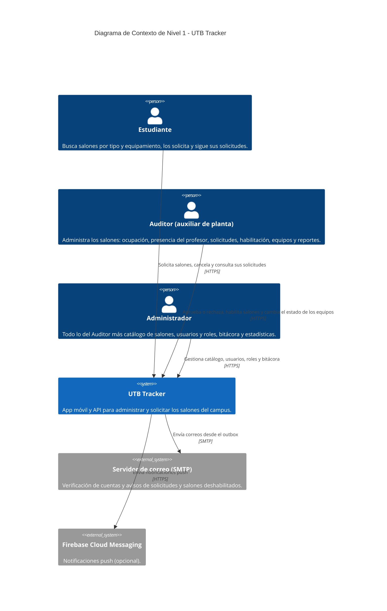

# Diagrama de Contexto (C4 - Nivel 1) - UTB Tracker

Actualizado el 2026-11-16 (ADR-0018 a ADR-0023). UTB Tracker administra los **salones** del
Campus Tecnológico de la UTB.

- Los salones **sí se solicitan**.
- Los equipos son **fijos** en cada salón y **no se prestan** (ADR-0010). Solo se controla su
  estado.

Los roles son etiquetas sobre los valores que ya estaban guardados (ADR-0018):

| Valor guardado | Etiqueta |
|---|---|
| `usuario_utb` | Estudiante |
| `auxiliar` | Auditor |
| `administrador` | Administrador |

"Auditor" es un **rol**. No tiene que ver con la bitácora de auditoría.

Correspondencia con el código:

| Elemento del diagrama | Dónde está en el código |
|---|---|
| Personas | `app/middleware/permisos.py` (tabla rol → permisos) |
| Sistema UTB Tracker | `app/` y `frontend/` |
| Correo | `app/service/correo.py` y `app/messaging/worker.py` |
| Push | `NotificadorFCM` en `app/messaging/worker.py` |
