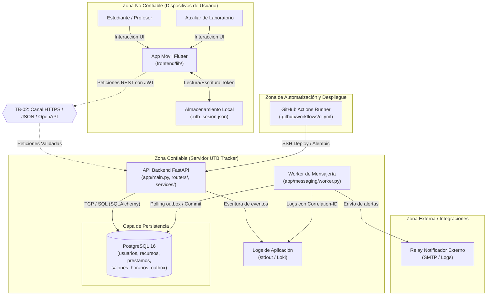

# Modelado de Amenazas y Plan de Mitigación — UTB Tracker

> **Documento verificado contra el código fuente del repositorio.**  
> Cada afirmación técnica incluye su ubicación exacta (`archivo:línea`).  
> Las mitigaciones no implementadas en el código se identifican explícitamente como **PROPUESTO — NO IMPLEMENTADO**.

---

## 1. Las Cuatro Preguntas del Modelado de Amenazas

Siguiendo el marco metodológico estándar de modelado de amenazas (Shostack), el análisis se estructura en torno a cuatro preguntas fundamentales:

### 1.1 ¿Qué estamos construyendo?
Estamos construyendo **UTB Tracker**, un sistema monolítico modular para la gestión de inventario, préstamo de equipos electrónicos (video beams, computadores portátiles, sistemas de audio) y reserva de salones de clase en la Universidad Tecnológica de Bolívar (UTB).

El sistema consta de cuatro contenedores principales según el C4 Nivel 2 (`docs/c4/C2.md`):
1. **App Móvil (`frontend/`):** Aplicación cliente desarrollada en Flutter (`frontend/pubspec.yaml:14-20`), utilizada por estudiantes, docentes y auxiliares de laboratorio. Se comunica con el backend mediante peticiones HTTPS transportando JSON validado contra el contrato OpenAPI (`docs/contracts/openapi.json`).
2. **API Backend (`app/`):** Servicio REST construido sobre FastAPI (`app/main.py:33-37`) estructurado en tres capas estrictas (`routers/`, `services/`, `models/`), encargado de la autenticación JWT, la validación de esquemas Pydantic y las reglas de negocio.
3. **Base de Datos (`app/core/database.py`):** Motor relacional PostgreSQL 16 en producción (SQLite en desarrollo local y pruebas locales). Almacena las tablas del dominio de autenticación (`usuarios`), recursos (`recursos`, `prestamos`, `idempotencia_registros`, `reportes`), salones (`salones`, `horarios`, `prestamos_salon`) y mensajería (`mensajes_outbox`, `notificaciones_procesadas`).
4. **Worker de Mensajería (`app/messaging/worker.py`):** Proceso consumidor desacoplado que sondea la tabla `mensajes_outbox` para enviar notificaciones asíncronas de préstamos a los correos de los usuarios mediante la abstracción `NotificadorBase`.

**Uso de IA en runtime:** El sistema **NO** integra modelos de lenguaje extenso (LLM) ni inteligencia artificial generativa en su flujo operativo de ejecución (`docs/arc42/arc42.md:403-407`). La IA se emplea exclusivamente como herramienta de ingeniería de software en fase de diseño y refactorización (`docs/ia.md`).

### 1.2 ¿Qué puede salir mal?
Pueden vulnerarse la disponibilidad, la integridad y la confidencialidad de la operación académica y física del campus:
- **Secuestro o elevación de privilegios:** Usuarios malintencionados pueden registrarse directamente como administradores o auxiliares al auto-asignarse el rol en el registro público (`app/services/auth.py:40-44`), o falsificar tokens JWT si se utilizan secretos por defecto (`app/core/config.py:14`).
- **Violación de privacidad y enumeración de usuarios:** Cualquier usuario autenticado puede cosechar nombres, correos y roles institucionales iterando IDs enteros secuenciales (`app/routers/auth.py:53-59`, `docs/adr/0007-identificadores-enteros-autoincrementales.md`).
- **Suplantación y manipulación de préstamos (BOLA / IDOR):** Un estudiante autenticado puede registrar préstamos asignados a terceros (`app/services/loans.py:46-48`) o devolver arbitrariamente préstamos de otros (`app/services/loans.py:146-181`).
- **Inconsistencias y conflictos físicos por condiciones de carrera:** Dos solicitudes concurrentes pueden reservar el mismo salón de clase (`app/services/prestamos_salon.py:114-138`) o insertar horarios académicos solapados (`app/services/horarios.py:89-106`) debido al patrón *check-then-act* sin bloqueo en base de datos.
- **Agotamiento de recursos y denegación de servicio:** Cargas concurrentes en horas pico (300 usuarios simultáneos, escenario QS-03) saturan el pool de 30 conexiones de PostgreSQL al carecer de capa de caché en lecturas (`app/core/database.py:18-24`, `docs/datos/diseno-cache.md`). La falta de rate limiting en el login expone el cómputo de `bcrypt` a saturación de CPU.
- **Fuga de credenciales en clientes móviles:** La app móvil persiste tokens de autenticación en texto plano en el sistema de archivos local (`frontend/lib/core/storage/token_storage.dart:18-19`), exponiéndolos en dispositivos comprometidos o compartidos.

### 1.3 ¿Qué hacemos al respecto?
Diseñamos e implementamos controles preventivos, correctivos y de detección:
- **Mitigaciones ya implementadas:**
  - Hashing robusto de contraseñas con sal dinámica irreversible mediante `bcrypt` (`app/core/hashing.py:12-21`, `app/services/auth.py:50`).
  - Bloqueo pesimista de fila `.with_for_update()` en la asignación de préstamos de equipos (`app/services/loans.py:58`).
  - Idempotencia en la creación de préstamos soportada por la cabecera `X-Idempotency-Key` y persistencia en `idempotencia_registros` (`app/routers/loans.py:38`, `app/services/loans.py:77-83`).
  - Trazabilidad y correlación estructurada extremo a extremo mediante `X-Request-ID` y `correlation_id` (`app/main.py:58-75`, `app/messaging/worker.py:26-29`).
  - Monitoreo profundo de salud con `GET /salud` ejecutando `SELECT 1` activo sobre el pool de PostgreSQL (`app/routers/health.py:20-33`).
  - Dependencias de autorización por rol `CurrentUser` y `AdminUser` (`app/core/deps.py:78-79`).
- **Mitigaciones propuestas (no implementadas aún):**
  - Restricción estricta del campo `rol` en registro público forzando `"usuario_utb"`.
  - Control de acceso a nivel de objeto (ABAC / propiedad del recurso) en endpoints de consulta y devolución (`ADR-0008`).
  - Restricciones declarativas de exclusión PostgreSQL (`EXCLUDE USING gist`) en préstamos de salones y horarios.
  - Almacenamiento seguro de tokens en el dispositivo móvil mediante `flutter_secure_storage`.
  - Limitación de tasa de peticiones (*rate limiting*) sobre `POST /auth/login` y endpoints de escritura.
  - Adopción de bloqueo `SKIP LOCKED` en el worker y su supervisión como servicio systemd.

### 1.4 ¿Hicimos un buen trabajo?
La verificación se evalúa a través de:
- Cobertura de pruebas automatizadas en `tests/` (`test_auth.py`, `test_loans.py`, `test_resilience.py`, `test_performance.py`, `test_messaging.py`).
- Auditoría continua de dependencias en el pipeline de CI (`.github/workflows/ci.yml:51-55`) mediante `pip-audit`.
- Medición de escenarios de calidad formales QS-01 a QS-06 definidos en `docs/arc42/arc42.md` sección 10.
- Documentación explícita de amenazas aceptadas y deudas técnicas en `docs/arc42/arc42.md` sección 11.
- Las verificaciones de T-01 a T-04 son pruebas propuestas, aún no escritas.

---

## 2. Activos y Fronteras de Confianza

### 2.1 Catálogo de Activos
- **ACT-01 (Credenciales y Hashes):** Contraseñas de usuarios almacenadas en la columna `usuarios.password`.
- **ACT-02 (Tokens de Sesión y Claves Criptográficas):** Tokens JWT firmados y las variables de entorno `SECRET_KEY`, `FORGET_PWD_SECRET_KEY`.
- **ACT-03 (Datos Personales de Usuarios):** Nombres completos, correos institucionales `@utb.edu.co` y roles académicos (`usuarios.nombre`, `usuarios.email`, `usuarios.rol`).
- **ACT-04 (Catálogo e Inventario Físico):** Seriales, categorías, salones asociados y estado físico de los equipos (`recursos.serial`, `recursos.estado`).
- **ACT-05 (Transacciones de Préstamo de Equipos):** Trazabilidad de asignaciones activas, fechas de devolución y exclusividad de uso (garantía QS-06).
- **ACT-06 (Disponibilidad y Ocupación de Salones):** Reservas de aulas (`prestamos_salon`) y programación horaria semestral (`horarios`).
- **ACT-07 (Cola de Notificaciones Outbox):** Eventos persistidos en `mensajes_outbox` y registros de deduplicación en `notificaciones_procesadas`.
- **ACT-08 (Logs y Métricas Operacionales):** Registros JSON de tráfico HTTP, latencias y mensajes diagnósticos del worker.
- **ACT-09 (Pipeline de Entrega Continua):** Secretos de GitHub Actions (`SSH_HOST`, `SSH_USER`, `SSH_PRIVATE_KEY`, `WORK_DIR`).

### 2.2 Fronteras de Confianza (Trust Boundaries)
1. **TB-01 (Frontera de Usuario / Dispositivo Móvil):** Separa al usuario final del almacenamiento local del dispositivo. La app móvil corre en hardware fuera del control de la universidad.
2. **TB-02 (Frontera de Red Externa / Canal API):** Separa la App Móvil (entorno no confiable) de la API Backend FastAPI alojada en la infraestructura del servidor. Cruza la red pública/campus vía HTTPS.
3. **TB-03 (Frontera de Servicios Internos / Persistencia):** Separa los procesos de aplicación (API Uvicorn y Worker) del motor de base de datos PostgreSQL en localhost/red interna.
4. **TB-04 (Frontera de Mensajería y Desacoplamiento):** Separa el productor de eventos (API FastAPI) del consumidor en segundo plano (Worker de mensajería) a través de las tablas outbox.
5. **TB-05 (Frontera de Notificaciones Externas):** Separa el Worker de mensajería del canal de despacho a usuarios; hoy el notificador es simulado y escribe en logs; el relay SMTP de la UTB es propuesto, no implementado.
6. **TB-06 (Frontera CI/CD y Administración):** Separa el repositorio de código y los runners de GitHub Actions del servidor de producción mediante SSH.

### 2.3 Diagrama de Fronteras de Confianza (Mermaid)

---

## 3. Análisis STRIDE por Elemento y Flujo

| Elemento / Flujo C4 | Spoofing | Tampering | Repudiation | Information Disclosure | Denial of Service | Elevation of Privilege |
|---|---|---|---|---|---|---|
| **App Móvil Flutter (`frontend/`)** | Suplantación de identidad si se copia el token de otro usuario. | Modificación de archivos de sesión local en disco. | No aplica en la capa visual. | Fuga de token JWT almacenado en `.utb_sesion.json` sin cifrar. | Bloqueo local de la app por corrupción de archivos de caché. | Uso de permisos auxiliares en dispositivos compartidos. |
| **Flujo HTTPS (App → API)** | Inyección de cabeceras de autorización falsificadas o reutilizadas. | Alteración de payloads en tránsito si no se valida certificado TLS. | Negación de haber realizado una solicitud si falta correlación. | Interceptación de datos en redes Wi-Fi inseguras sin pinning de certificados. | Inundación de peticiones HTTP en endpoints sin límite de tasa. | Envío de tokens con claims de rol alterados si la clave es débil. |
| **API Backend (`app/routers/`, `app/services/`)** | Creación de cuentas con nombres duplicados o usurpando identidades. | Modificación check-then-act en préstamos de salones y horarios. | Modificación de registros sin registrar auditoría de usuario autorizador. | Exposición de perfiles completos en `GET /auth/user/{id}`. | Agotamiento de CPU por hashing masivo de contraseñas sin rate limiting. | Auto-asignación de rol `"administrador"` en `POST /auth/register`. |
| **Persistencia (`app/models/`, PostgreSQL)** | Inserción directa de registros simulando transacciones reales. | Corrupción de invariantes por ausencia de restricciones GiST o UNIQUE. | No aplica si hay integridad referencial activa. | Fuga de credenciales en respaldos no cifrados de la base de datos. | Agotamiento del pool de conexiones (30 conexiones máx) por lecturas sin caché. | Elevación por inyección SQL (mitigado nativamente por SQLAlchemy ORM). |
| **Worker (`app/messaging/`)** | Inyección de mensajes espurios directamente en `mensajes_outbox`. | Manipulación del estado de mensajes pendientes en base de datos. | Reintentos que reenvían correos que el usuario puede alegar no solicitados. | Exposición de correos electrónicos en texto claro en los logs del worker. | Bloqueo o duplicación masiva entre múltiples workers sin `SKIP LOCKED`. | Procesamiento de versiones no compatibles del contrato de eventos. |
| **CI/CD (`ci.yml`, Deploy)** | Despliegue desde ramas no autorizadas si se alteran reglas de protección. | Modificación del pipeline para inyectar scripts maliciosos en el servidor. | Despliegues automáticos sin registro formal del autor del commit. | Exposición de secretos de SSH (`SSH_PRIVATE_KEY`) en logs de ejecución. | Caída del servicio en despliegue si falla `alembic upgrade head`. | Ejecución de comandos sudo sin restricción en el servidor destino. |

---

## 4. Tabla de Amenazas Priorizadas (P × I)

La probabilidad (P) y el impacto (I) se califican en escala de 1 a 5, resultando en un riesgo inherente de 1 a 25.
Los responsables corresponden a responsables propuestos; la asignación se confirma en reunión del equipo. Miembros del equipo: **Sebastián García Devoz**, **Joriel Samir Barro** y **Mateo Millán**.

| ID | Elemento C4 | STRIDE | Atacante y Qué Gana | Descripción Técnica | Evidencia (`archivo:línea`) | P | I | Riesgo (P×I) | Mitigación Concreta | Estado | Responsable | Verificación |
|---|---|---|---|---|---|---|---|---|---|---|---|---|
| **T-01** | API Backend | Elevation of Privilege | Usuario anónimo; gana control administrativo total del sistema. | El endpoint de registro público aceptaba cualquier rol incluido en la tupla `("usuario_utb", "administrador", "auxiliar")`, permitiendo que un atacante envíe `{"rol": "administrador"}` y se autoproclame administrador. | `app/services/auth.py:40-44`, `app/schemas/auth.py:18` | 5 | 5 | **25** | Forzar `rol = "usuario_utb"` en `create_user` para registros públicos; crear endpoint administrativo separado para delegar roles. | **PROPUESTO — NO IMPLEMENTADO** *(Mitigado en main vía commit `bf1debc`)* | Sebastián García Devoz | Test unitario enviando `{"rol": "administrador"}` en `POST /auth/register` y verificando que quede como `usuario_utb`. |
| **T-02** | API Backend | Spoofing / Elevation of Privilege | Atacante externo; falsifica tokens JWT de cualquier usuario y rol. | Si la variable `SECRET_KEY` no se define en el entorno desplegado, el sistema utiliza el valor hardcodeado por defecto `"change-me-in-production"`, permitiendo forjar firmas HMAC-SHA256 válidas (ver T-22). | `app/core/config.py:14,21` | 4 | 5 | **20** | Requerir obligatoriamente `SECRET_KEY` en producción y lanzar `RuntimeError` en `config.py` si tiene el valor por defecto o longitud < 32 bytes. | **PROPUESTO — NO IMPLEMENTADO** | Mateo Millán | Test de configuración que intente iniciar la app sin variable de entorno y verifique el fallo de arranque. |
| **T-03** | API Backend | Information Disclosure | Usuario autenticado; extrae listado completo de usuarios, correos y roles. | `GET /auth/user/{user_id}` solo exige autenticación genérica (`CurrentUser`). Como los IDs son enteros secuenciales (ADR-0007), un bucle puede enumerar la totalidad del directorio de usuarios de la UTB. | `app/routers/auth.py:53-59`, `app/services/auth.py:118-124`, `docs/adr/0007-identificadores-enteros-autoincrementales.md` | 5 | 4 | **20** | Modificar `get_user_endpoint` para exigir `AdminUser` o restringir la respuesta a `if current_user.id == user_id`. | **PROPUESTO — NO IMPLEMENTADO** | Joriel Samir Barro | Test en `tests/test_auth.py` verificando HTTP 403 al consultar perfil ajeno con token de `usuario_utb`. |
| **T-04** | API Backend | Spoofing / Tampering | Usuario autenticado; solicita préstamos a nombre de otros usuarios. | El endpoint `POST /prestamos` acepta un `usuario_id` arbitrario en el cuerpo JSON de la petición sin validar que coincida con el usuario del token (`current_user.id`) ni que el solicitante sea un auxiliar. | `app/routers/loans.py:34-42`, `app/services/loans.py:46-48`, `app/schemas/schemas.py:59-63` | 5 | 4 | **20** | Validar `if datos.usuario_id != current_user.id and current_user.rol not in ("administrador", "auxiliar"): raise 403`. | **PROPUESTO — NO IMPLEMENTADO** | Sebastián García Devoz | Test de autorización intentando crear préstamo con `usuario_id` ajeno esperando HTTP 403. |
| **T-05** | API Backend / BD | Tampering | Dos usuarios concurrentes; reservan el mismo salón a la misma hora. | Condición de carrera *check-then-act* en `_validar_cruce_fechas`. Dos peticiones paralelas leen ausencia de solapamiento en memoria y ambas confirman en BD, generando doble reserva sobre el mismo espacio físico. | `app/services/prestamos_salon.py:38-78, 114-138`, `docs/datos/consistencia-por-operacion.md:104-116` | 4 | 4 | **16** | Restricción de exclusión PostgreSQL `EXCLUDE USING gist (salon_id WITH =, tsrange(fecha_inicio, fecha_fin) WITH &&)` en `prestamos_salon` o bloqueo pesimista en `Salon`. | **PROPUESTO — NO IMPLEMENTADO** | Mateo Millán | Prueba concurrente con 10 hilos intentando reservar el mismo salón en el mismo intervalo horario. |
| **T-06** | API Backend / BD | Tampering | Usuario autenticado; devuelve préstamos de otros o genera doble devolución. | `PATCH /prestamos/{id}/devolver` no verifica que el usuario autenticado sea el titular del préstamo o administrador, y lee el préstamo sin bloqueo pesimista, permitiendo doble devolución en peticiones paralelas. | `app/routers/loans.py:64-81`, `app/services/loans.py:146-181`, `docs/datos/consistencia-por-operacion.md:127-139` | 4 | 4 | **16** | Validar titularidad/rol en `devolver_prestamo` y aplicar cerrojo pesimista `.with_for_update()` sobre la fila del préstamo. | **PROPUESTO — NO IMPLEMENTADO** | Joriel Samir Barro | Test automatizado verificando HTTP 403 para usuarios no autorizados y validación de serialización concurrente. |
| **T-07** | API Backend / BD | Tampering | Auxiliares concurrentes; insertan horarios académicos solapados. | La función `_validar_solapamiento` opera en memoria mediante consulta ordinaria. Dos llamadas simultáneas pueden registrar materias solapadas en el mismo salón y día. | `app/services/horarios.py:27-58, 89-106`, `docs/datos/consistencia-por-operacion.md:117-126` | 3 | 4 | **12** | Implementar restricción de exclusión PostgreSQL `EXCLUDE USING gist` en la tabla `horarios`. | **PROPUESTO — NO IMPLEMENTADO** | Mateo Millán | Script de prueba concurrente insertando horarios solapados y verificando rechazo con `IntegrityError`. |
| **T-08** | API Backend / BD | Denial of Service | 300 usuarios concurrentes en hora pico; saturan conexiones de BD. | Las consultas de catálogo, salones y disponibilidad se ejecutan directamente sobre PostgreSQL en cada request. Sin capa de caché, 300 usuarios simultáneos saturan el pool de 30 conexiones (`pool_size=10, max_overflow=20`). | `app/core/database.py:18-24`, `app/services/resources.py:15-28`, `docs/datos/diseno-cache.md:1-50` | 4 | 3 | **12** | Implementar capa de caché en memoria acotada por TTL (60s recursos / 120s salones) con invalidación por versión ante escrituras (`docs/datos/diseno-cache.md`). | **PROPUESTO — NO IMPLEMENTADO** | Sebastián García Devoz | Ejecutar `tests/test_performance.py` con 300 hilos evaluando tasa de fallos por `TimeoutError` en el pool. |
| **T-09** | API Backend | Denial of Service / Spoofing | Atacante externo; adivina contraseñas y agota CPU con hashing. | No existe limitador de peticiones en la API ni en `POST /auth/login`. Un atacante puede ejecutar ataques de diccionario masivos saturando los núcleos de CPU por el alto costo computacional de `bcrypt`. | `app/routers/auth.py:21-26`, `app/services/auth.py:64-75`, `app/core/hashing.py:12-21` | 4 | 3 | **12** | Integrar middleware de limitación de tasa (*rate limiting*) limitando `POST /auth/login` a máximo 5 intentos por minuto por IP. | **PROPUESTO — NO IMPLEMENTADO** | Mateo Millán | Enviar 20 peticiones seguidas a `/auth/login` y verificar respuesta HTTP 429 Too Many Requests a partir de la 6ta. |
| **T-10** | Worker Mensajería | Denial of Service / Repudiation | Instancias concurrentes del worker; envían notificaciones duplicadas. | La consulta de mensajes pendientes en `app/messaging/worker.py:145-153` no implementa `SKIP LOCKED`. Si se levantan múltiples workers, ambos procesan el mismo lote. Además, el worker no se arranca en el despliegue automático. | `app/messaging/worker.py:145-153`, `.github/workflows/ci.yml:77-78`, `run.sh:19`, `docs/datos/consistencia-por-operacion.md:82-97` | 4 | 3 | **12** | Añadir `.with_for_update(skip_locked=True)` en la consulta del outbox y configurar servicio systemd supervisado para el worker en producción. | **PROPUESTO — NO IMPLEMENTADO** | Joriel Samir Barro | Test con dos instancias concurrentes procesando el outbox verificando que ningún `message_id` sea enviado dos veces. |
| **T-11** | App Móvil | Information Disclosure | Malware en dispositivo o atacante físico; extrae credenciales de sesión. | `TokenStorage` persiste el token JWT en un archivo plano en disco (`.utb_sesion.json`) sin cifrado en lugar de usar el almacenamiento protegido del sistema operativo (Keystore / Keychain). | `frontend/lib/core/storage/token_storage.dart:11, 18-19, 31-36` | 3 | 4 | **12** | Migrar `TokenStorage` a la librería `flutter_secure_storage` respaldada por hardware criptográfico en Android/iOS. | **PROPUESTO — NO IMPLEMENTADO** | Sebastián García Devoz | Inspeccionar el sistema de archivos del emulador/dispositivo y comprobar la ausencia de archivos JSON en claro. |
| **T-12** | Base de Datos | Spoofing / Denial of Service | Atacante concurrente; bloquea acceso de un usuario legítimo. | La columna `Usuario.nombre` carece de restricción `unique=True` en BD. Como el login busca estrictamente por nombre (`auth.py:70`), registrar nombres homónimos rompe el inicio de sesión. | `app/models/auth_models.py:19`, `app/services/auth.py:26-31, 70`, `docs/datos/consistencia-por-operacion.md:140-149` | 3 | 4 | **12** | Agregar `unique=True, index=True` a `Usuario.nombre` en `auth_models.py` y generar migración Alembic. | **PROPUESTO — NO IMPLEMENTADO** | Joriel Samir Barro | Migración Alembic ejecutada y prueba de inserción duplicada esperando `IntegrityError`. |
| **T-13** | Entorno Local / CI | Tampering | Entorno de desarrollo; permite paso inadvertido de condiciones de carrera. | La cláusula `with_for_update()` se desactiva deliberadamente si el dialecto de BD es SQLite. Las pruebas locales que usan SQLite no validan las garantías de exclusión mutua de QS-06. | `app/services/loans.py:54-60`, `app/core/database.py:27`, `docs/datos/consistencia-por-operacion.md:150-158` | 3 | 4 | **12** | Estandarizar la suite de pruebas local mediante contenedor Docker con PostgreSQL idéntico al servicio de CI (`ci.yml:11-28`). | **PROPUESTO — NO IMPLEMENTADO** | Mateo Millán | Ejecutar la suite de pruebas sobre PostgreSQL local verificando el comportamiento de `with_for_update()`. |
| **T-22** | CI/CD y API Backend | Tampering / Elevation of Privilege | Atacante externo; explota vulnerabilidades conocidas en librerías del backend. | `starlette 0.50.0` contiene PYSEC-2026-161 (omisión de validación de Host) y `pyjwt 2.12.1` contiene GHSA-pxh4-856f-4h89 (aceptación de clave vacía en HMAC simétrico, reforzando el riesgo de T-02). | `requirements.txt`, `docs/seguridad/analisis-dependencias.md`, `.github/workflows/ci.yml:51-55` | 4 | 3 | **12** | Actualizar versiones (`starlette >= 1.0.1`, `pyjwt >= 2.14.0`) y mantener `pip-audit` en CI. | **PROPUESTO — NO IMPLEMENTADO** | Joriel Samir Barro | pip-audit sin hallazgos altos. |
| **T-15** | API Backend / Worker | Information Disclosure | Operador de logs o intruso; recolecta correos personales. | `NotificadorSimulado` imprime el correo electrónico del destinatario en texto claro en los logs estándar de la aplicación. | `app/messaging/worker.py:91-97` | 4 | 2 | **8** | Aplicar máscara sobre el correo en las líneas de log (`j***o@utb.edu.co`). | **PROPUESTO — NO IMPLEMENTADO** | Joriel Samir Barro | Inspección de la salida de logs del worker comprobando que ningún correo aparezca completo. |
| **T-16** | API Backend | Spoofing | Atacante externo; vulnera cuentas con contraseñas triviales. | `UsuarioCreate` solo exige longitud mínima de 6 caracteres para la contraseña, sin restricciones de complejidad ni chequeo contra listas de contraseñas vulnerables conocidas. | `app/schemas/auth.py:19` | 4 | 2 | **8** | Incrementar longitud mínima a 8 caracteres y añadir validadores Pydantic que exijan alfanuméricos y símbolos. | **PROPUESTO — NO IMPLEMENTADO** | Mateo Millán | Prueba unitaria intentando registrar usuario con password `"123456"` esperando HTTP 422 Unprocessable Entity. |
| **T-17** | API Backend | Elevation of Privilege / Spoofing | Usuario desvinculado; sigue usando el token hasta que expire. | El cierre de sesión (`POST /auth/logout`) es meramente declarativo y no revoca el token JWT. El token sigue siendo aceptado por `get_current_user` hasta agotar su tiempo de expiración (60 minutos). | `app/services/auth.py:137-143`, `app/core/security.py:15-20`, `app/core/deps.py:35-57` | 2 | 4 | **8** | Reducir ACCESS_TOKEN_EXPIRE_MINUTES; sin lista negra de revocación (ver A-03). | **ACEPTADA, ver A-03** | Sebastián García Devoz | Test ejecutando petición autenticada inmediatamente después de llamar a `logout` esperando HTTP 401. |
| **T-14** | API Backend | Information Disclosure / Tampering | Cualquier origen web; con CORS_ORIGINS='*' y allow_credentials=True la API acepta peticiones cruzadas. | El token viaja en el header Authorization, no en cookie, así que el navegador no lo adjunta solo. Sin embargo, una configuración permisiva en CORS_ORIGINS expone la API a peticiones cruzadas desde dominios no confiables. | `app/core/config.py:24`, `app/main.py:42-48`, `app/core/deps.py:17-33` | 2 | 3 | **6** | Configurar orígenes estrictos en producción (`https://tracker.utb.edu.co`) y rechazar comodín `*` cuando las credenciales están habilitadas. | **PROPUESTO — NO IMPLEMENTADO** | Sebastián García Devoz | Petición HTTP OPTIONS desde un origen no autorizado (`http://malicious.com`) verificando ausencia de cabeceras CORS. |
| **T-18** | Base de Datos | Denial of Service | Cliente automatizado; desborda tabla de idempotencia. | La tabla `idempotencia_registros` no tiene mecanismo de depuración temporal (TTL). A largo plazo, el acumulado de claves de idempotencia satura el almacenamiento de la base de datos. | `app/models/recurso_models.py:59-73`, `app/services/loans.py:77-83` | 2 | 3 | **6** | Configurar tarea periódica o cron job que elimine registros con antigüedad superior a 24 horas. | **PROPUESTO — NO IMPLEMENTADO** | Mateo Millán | Ejecución de script de mantenimiento verificando la eliminación de claves expiradas. |
| **T-21** | Base de Datos | Information Disclosure | Intruso con copia de BD; compromete credenciales de los usuarios. | Almacenamiento de contraseñas de acceso en texto claro o con funciones débiles como MD5/SHA1. | `app/core/hashing.py:12-21`, `app/services/auth.py:50` | 1 | 5 | **5** | Hashing irreversible mediante biblioteca nativa `bcrypt` con generación de sal aleatoria automática por cada credencial. | **IMPLEMENTADA** (`app/core/hashing.py:13`, `app/services/auth.py:50`) | Sebastián García Devoz | Sin prueba dedicada; el hashing se ejercita de forma indirecta en las pruebas de registro y login de tests/test_auth.py (`test_registro_usuario_exitoso`, `test_login_exitoso_genera_jwt`). |
| **T-19** | API Backend / BD | Tampering | Dos usuarios simultáneos; intentan prestar el mismo equipo físico. | Doble asignación de préstamo para un mismo equipo electrónico en estado disponible. | `app/services/loans.py:50-75`, `app/models/recurso_models.py:44-57` | 1 | 4 | **4** | Bloqueo pesimista de fila `.with_for_update()` en PostgreSQL ejecutado en transacción atómica única junto al cambio de estado a `"prestado"`. | **IMPLEMENTADA** (`app/services/loans.py:58`) | Sebastián García Devoz | Verificado en `tests/test_loans.py` (`test_prestamo_exitoso_cambia_estado_del_recurso`, `test_no_permite_prestar_recurso_no_disponible`) y `tests/test_performance.py` (`test_concurrencia_solicitudes_simultaneas`); solo cuenta si la suite corre contra PostgreSQL en CI; con SQLite with_for_update() está desactivado (ver T-13). |
| **T-20** | Red / API Backend | Tampering / Repudiation | Cliente móvil en Wi-Fi inestable; duplica reservas por reintento. | Un reintento automático de la app móvil ante una desconexión transitoria podía generar dos registros de préstamo distintos para la misma intención de usuario. | `app/routers/loans.py:38`, `app/services/loans.py:77-83`, `app/models/recurso_models.py:59-73` | 1 | 4 | **4** | Cabecera `X-Idempotency-Key` respaldada por `idempotencia_registros`. Reintentos devuelven el registro original sin duplicar. | **IMPLEMENTADA** (`app/routers/loans.py:38`, `app/services/loans.py:77-83`) | Sebastián García Devoz | `tests/test_resilience.py::test_idempotencia_prestamo_con_misma_clave` y `tests/test_messaging.py::test_idempotencia_http_con_x_idempotency_key`. |

---

## 5. Amenazas Aceptadas (Justificación Arquitectónica)

Las siguientes amenazas fueron analizadas y deliberadamente aceptadas por el equipo, documentándose como deudas técnicas asumidas en la Sección 11 de `docs/arc42/arc42.md`:

### A-01: Ausencia de Garantía de Orden Cronológico Global en Mensajes Outbox
- **Categoría:** Repudiation / Information Disclosure.
- **Justificación:** El outbox procesa notificaciones de préstamos (`prestamo.creado`). Si un mensaje $M_1$ falla y entra en reintento con backoff exponencial, un mensaje posterior $M_2$ puede ser entregado antes (`app/messaging/worker.py:266-277`). Dado que las notificaciones son informativas y atañen a transacciones independientes de usuarios distintos, el orden estricto de llegada de correos no compromete la consistencia del inventario físico ni los estados de la base de datos (garantía transaccional ya confirmada en `db.commit()` local). Introducir ordenamiento estricto requeriría colas FIFO particionadas por usuario (RabbitMQ o Kafka), lo que viola el principio de simplicidad operativa del monolito (ADR-0005).

### A-02: Entrega Al Menos Una Vez (At-Least-Once) con Potenciales Duplicados por Caída del Worker
- **Categoría:** Repudiation.
- **Justificación:** Si el worker invoca con éxito al notificador externo (`app/messaging/worker.py:250`), pero el proceso es terminado por el sistema operativo antes de persistir la marca en `notificaciones_procesadas` (`db.add(procesado)` y `db.commit()` en `worker.py:282-291`), el mensaje permanecerá en estado `"pendiente"`. Al recuperarse, otro ciclo del worker volverá a enviar el correo al usuario. Este riesgo se asume como inherente al desacoplamiento at-least-once sin transacción distribuida de dos fases (2PC) incompatibles con protocolos de notificación como SMTP.

### A-03: Validación Sin Estado de Tokens JWT sin Lista Negra de Revocación Inmediata
- **Categoría:** Spoofing / Elevation of Privilege.
- **Justificación:** Se preserva el diseño *stateless* de la API para mantener el alto rendimiento y la capacidad de atención en horas pico (QS-02, QS-03). Los tokens cuentan con un tiempo de expiración acotado (60 minutos por defecto en `ACCESS_TOKEN_EXPIRE_MINUTES`). Implementar revocación en tiempo real forzaría una consulta a Redis o a la base de datos en cada petición HTTP, erosionando la ventaja de verificación local del token elegida en el ADR-0004. La ventana de riesgo se considera tolerable para el contexto universitario durante el semestre actual.
